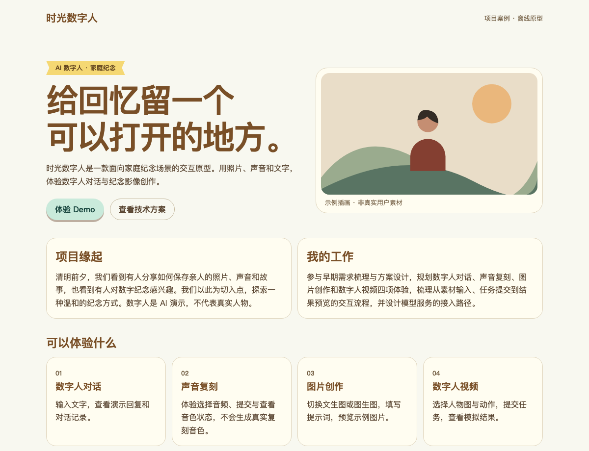

# 时光数字人

一个面向家庭纪念场景的 AI 数字人交互原型。动森风界面以照片、声音和文字为入口，展示数字人对话与纪念影像创作的过程。

## 快速体验

直接双击 `index.html` 打开项目展示首页，再点击「体验 Demo」，或直接打开 `demo.html`。无需安装依赖、启动服务或填入密钥。后续可以把这个目录作为站点根目录发布。

[查看交互 Demo 截图](screenshots/demo.png) · [查看 API 接口方案](API.md)

## 功能状态

| 功能 | 当前可体验 | 真实接入 |
| --- | --- | --- |
| 数字人对话与历史 | 发送文字、查看模拟回复与会话记录 | 豆包对话、ASR、TTS 待接入 |
| 声音复刻 | 选择本地音频、提交、查看模拟训练状态 | 豆包声音复刻待接入 |
| 图片创作 | 文生图／图生图表单与固定示例图 | Nano Banana 待接入 |
| 数字人视频 | 素材选择、提交、查询进度与浏览器生成的模拟样片 | Seedance 待接入 |

模型、微信登录和录音均为离线演示，素材不会上传，刷新会清除当前会话。

## 文件说明

- `index.html`：面试展示首页；`demo.html`：交互演示。
- `runtime.js`：浏览器适配与本地模拟服务；`bundle.js`：打包的页面、图标与交互逻辑。
- `themes.css`、`showcase.css`：动森风 Demo 与展示首页样式。

## 公开发布前

- 本目录不含朋友发来的原始程序包、苹果版或私人素材。
- **仍需确认授权：** `bundle.js` 包含从原版提取的页面、样式、交互逻辑和图标。这些内容随 Demo 工作；公开 GitHub 仓库或部署在线演示之前，需要确认可以公开分发。若不能公开，需替换相关实现和素材。
- 当前是本地发布候选，尚未上传或部署。

验证入口：用浏览器打开 `demo.html?smoke=1`。
